<div align="center">


# RdpHelper

**One-click Windows Remote Desktop & OpenSSH · Custom ports · IP allow/deny lists · On-demand tunneling**

Windows 11 Settings look · Acrylic glass · Single self-contained exe

[](https://github.com/Flowers-hurt/RdpHelper/actions/workflows/build.yml)
[](https://github.com/Flowers-hurt/RdpHelper/releases/latest)
[](https://github.com/Flowers-hurt/RdpHelper/releases)
[](LICENSE)
<br/>
[](#-requirements)
[](https://dotnet.microsoft.com/)
[](https://github.com/lepoco/wpfui)
[](#-automated-testing)

[简体中文](README.md) | **English**

[🌐 Website](https://flowers-hurt.github.io/RdpHelper/)

</div>

> [!NOTE]
> The UI is available in **English and Simplified Chinese**. It follows the Windows display language by default; switch it any time under *Settings → Language*.

## 📖 Overview

Letting someone remote into a Windows PC usually means digging through Settings, fiddling with the firewall, editing the registry to change the port, looking up the IP — and finding a tunneling tool when you're not on the same network.

**RdpHelper** wraps all of that into a small tool styled like Windows 11 Settings: **one toggle to enable Remote Desktop or SSH, one button to change / restore the port, one button to copy connection info for the other person**. When you need internet access, the default is **bore** (no account, ~1 MB client); advanced users can pick Cloudflare or ngrok under *More providers*. Clients are downloaded on demand and the public address is reported automatically.

The installer ships **no tunneling binaries**; they are fetched from their official sources only when you click *Download*.

## ✨ Features

| Area | Feature | Details |
| :-- | :-- | :-- |
| 🖥️ **Remote Desktop** | Enable / disable | Sets `fDenyTSConnections`, opens the firewall, starts `TermService` |
| | Network Level Authentication | Toggle (recommended on) |
| | Custom / random port, restore 3389 | `PortNumber` → firewall (TCP+UDP) → safe service restart |
| | LAN IP list | Ethernet / Wi-Fi detection, virtual adapters flagged |
| | Copy connection info | Computer name, user, LAN / public address, how-to (**no password**) |
| 🐚 **SSH** | Install OpenSSH Server | The official Win32-OpenSSH MSI is **bundled** (offline, seconds); falls back to the Windows optional feature / online download; progress bar + log that survive page switches |
| | Start / stop sshd | Sets auto-start and firewall |
| | Custom port / restore 22 | Rewrites `Port` in `sshd_config`, restarts sshd |
| 🛡️ **Access control** | IP allow list | Empty = allow all; otherwise only listed sources |
| | IP deny list | Always wins (firewall Block beats Allow) |
| | Formats | IPv4 / IPv6, CIDR, ranges `a-b`, `LocalSubnet` |
| 🌐 **Tunneling** | bore ⭐ recommended | Shown by default: open source, ~1 MB, no account; visitors use plain mstsc with `bore.pub:port` |
| | Cloudflare Tunnel (more providers) | No account, free; built-in visitor side |
| | ngrok (more providers) | Authtoken setup, `tcp://x.tcp.ngrok.io:port` |
| | RDP or SSH | Child processes live in a Job Object and die with the app |
| 👤 **Accounts** | Blank password / Microsoft account detection | Windows refuses remote sign-in without a password; the RDP and SSH pages warn you |
| | Set the account password | One click for local accounts; Microsoft accounts link to the website |
| | Dedicated remote account | Your own user name and password, added to Remote Desktop Users; disable / reset / delete |
| | SSH public keys | Paste a key or choose / drop a `.pub` file; warns if you pick a private key; optionally disable SSH password auth |
| 🎨 **UI** | Fluent design | NavigationView + cards like Windows Settings |
| | Glass | Acrylic / Mica / Mica Alt; light / dark / system |
| | 🌐 Bilingual | English / 简体中文 / follow system, switches instantly; shared connection info follows the language |

## 📸 Screenshots

> Rendered at **2× resolution** by CI on real Windows (`--gui-selftest`); all states are live data. The CI VM has no Windows 11 acrylic compositor, so the glass backdrop is simulated.

| Remote Desktop (dark) | Access control |
| :-: | :-: |
| 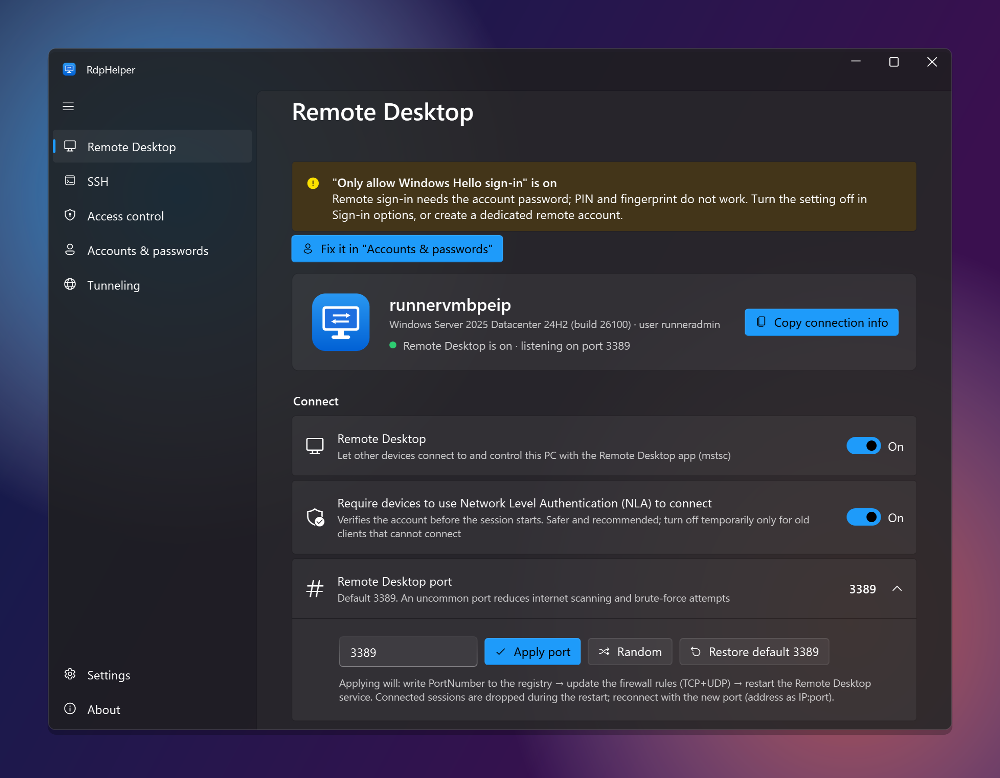 | 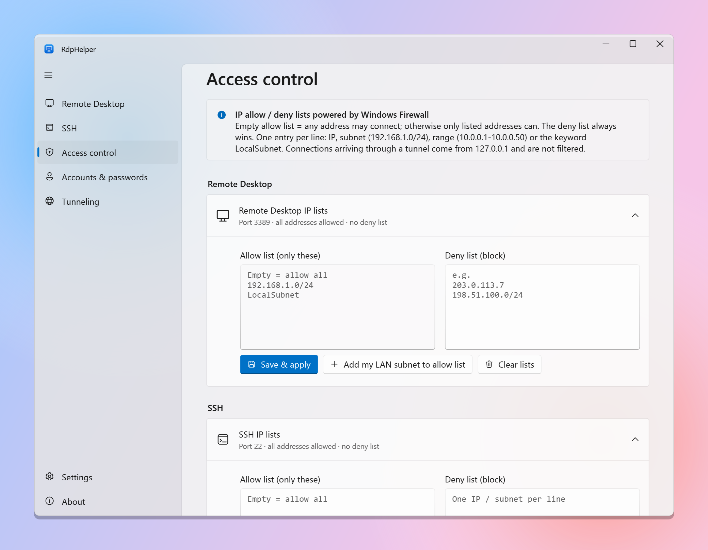 |
| **SSH** | **Tunneling** |
| 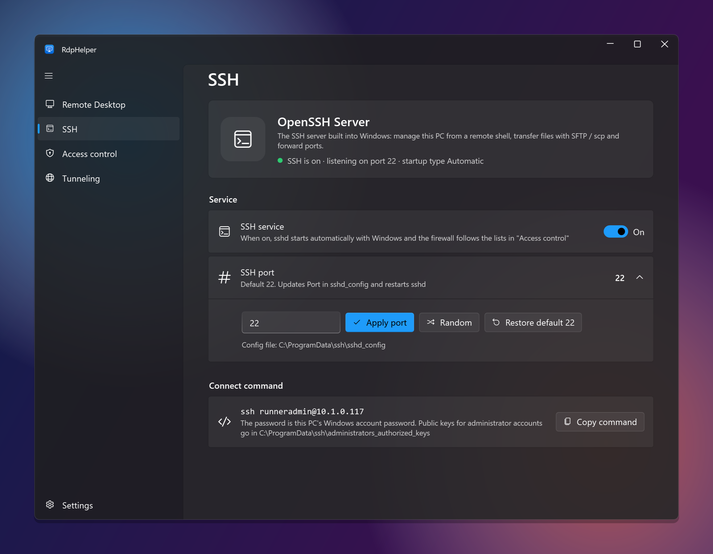 | 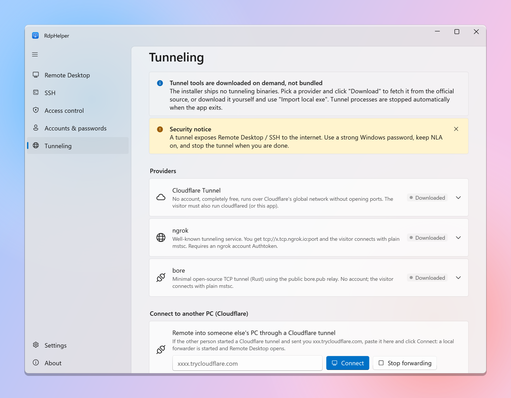 |
| **Settings** | **Remote Desktop (light)** |
| 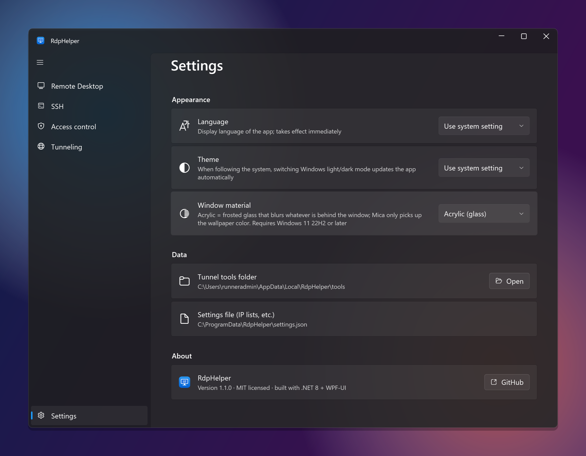 | 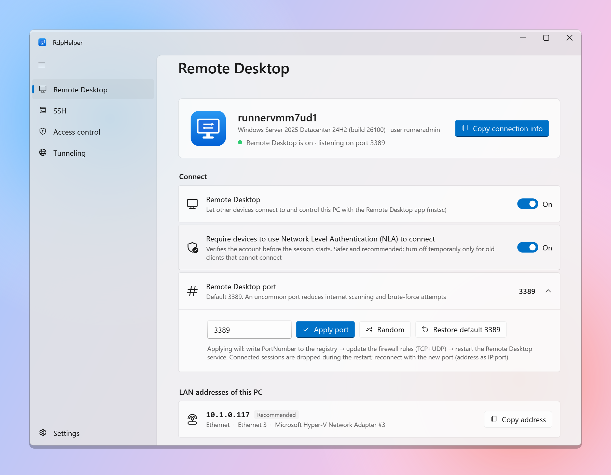 |
| **Installing OpenSSH (progress kept across pages)** | **Home edition: upgrade to Pro (simulated on CI)** |
| 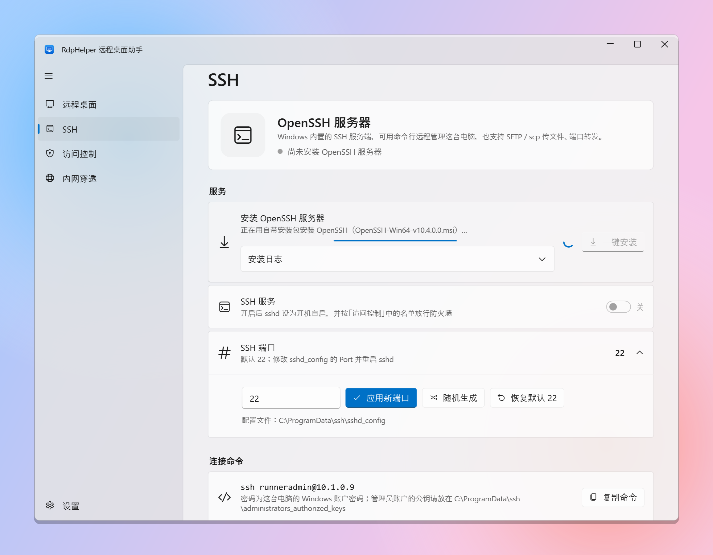 | 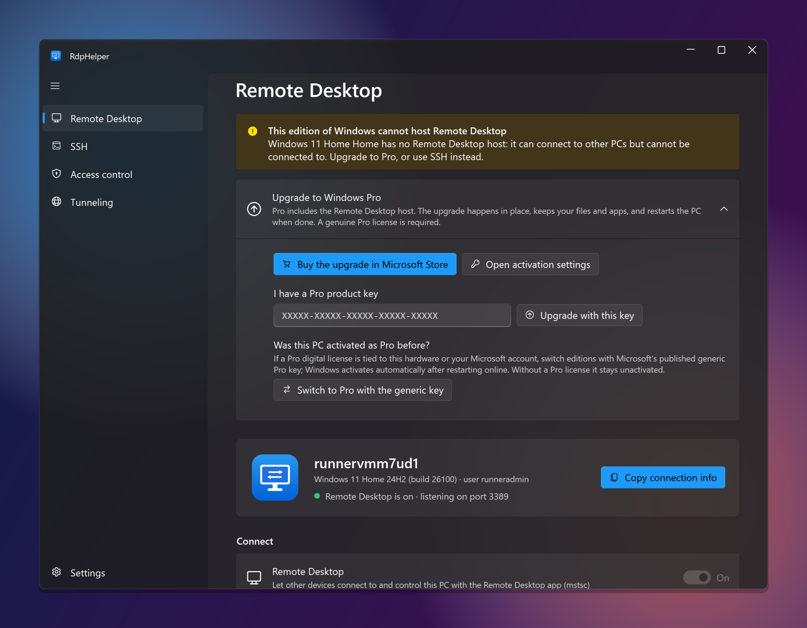 |
| **Accounts & passwords** | **About** |
| 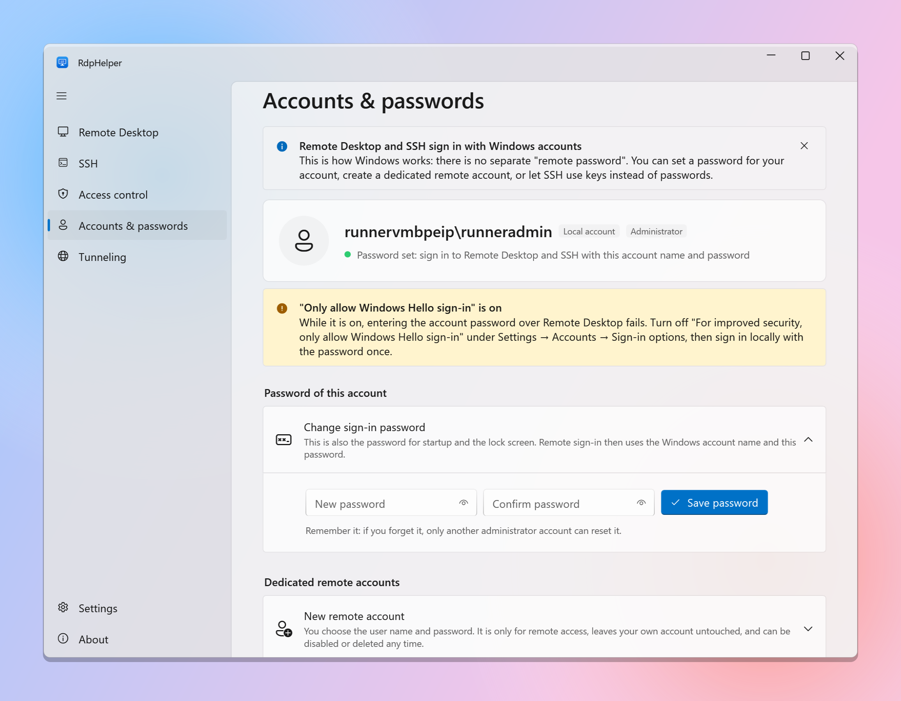 | 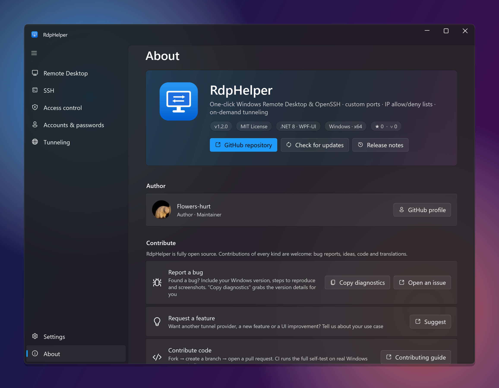 |

## 📦 Download

Grab the latest build from [**Releases**](https://github.com/Flowers-hurt/RdpHelper/releases/latest):

| File | Description |
| :-- | :-- |
| `RdpHelper-Setup-x.y.z-x64.exe` | Installer; uninstall removes the app's firewall rules |
| `RdpHelper-x.y.z-portable-x64.zip` | Portable single exe |

Both are self-contained (~60 MB), no .NET runtime required, and bundle the official Win32-OpenSSH MSI (`redist\`, ~7 MB, license included) for offline SSH server installs. Tunnel clients are still downloaded on demand. Administrator rights are required (UAC prompt).

### 🧰 Requirements

| Item | Requirement |
| :-- | :-- |
| OS | Windows 10 1809+ / Windows 11 / Windows Server 2019+ (x64) |
| Edition | The host must be **Pro / Enterprise / Education / Server** — Home has no RDP host (SSH works). On Home the app offers a legitimate upgrade to Pro: Microsoft Store, your own Pro key via `changepk.exe`, or the generic Pro key for PCs with a Pro digital license |
| Glass effect | Windows 11 22H2 (build 22621) or later; otherwise falls back to solid |

## 🔬 How it works

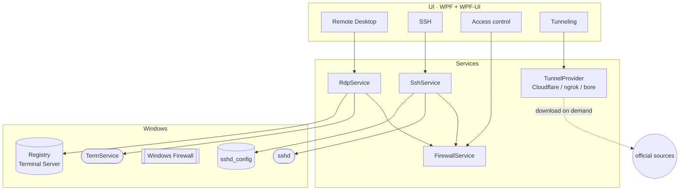

| Registry | Value | Meaning |
| :-- | :-- | :-- |
| `HKLM\SYSTEM\CurrentControlSet\Control\Terminal Server` | `fDenyTSConnections` | `0` allow, `1` deny |
| `…\WinStations\RDP-Tcp` | `PortNumber` | Listening port (default `3389`) |
| `…\WinStations\RDP-Tcp` | `UserAuthentication` | `1` = require NLA |

**Firewall takeover.** When a service is enabled RdpHelper disables the built-in *Remote Desktop* rule group (located by its resource id `@FirewallAPI.dll,-28752`, so it is language-independent) and `OpenSSH-Server-In-TCP`, and manages its own `RdpHelper-*` rules so port and lists always stay in sync:

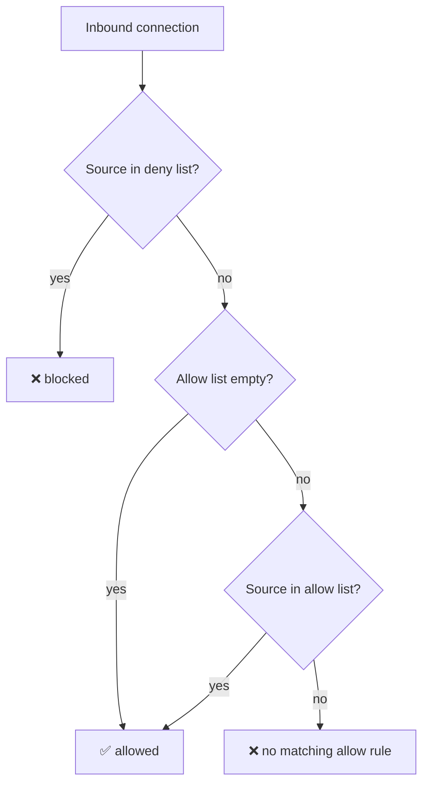

> [!IMPORTANT]
> Connections arriving through a tunnel originate from `127.0.0.1` and are **not** filtered by the lists. Use a strong password and keep NLA on when exposing a machine.

## 🌐 Tunneling

| | Cloudflare Tunnel | ngrok | bore |
| :-- | :-: | :-: | :-: |
| Where in the app | More providers | More providers | **Default · recommended** |
| Account | ❌ | ✅ Authtoken | ❌ |
| Cost | Free | Free tier (TCP needs card verification) | Free |
| Address | `xxx.trycloudflare.com` | `x.tcp.ngrok.io:port` | `bore.pub:port` |
| Plain mstsc on visitor side | ❌ needs `cloudflared access` (built in) | ✅ | ✅ |
| Download size | ~52 MB | ~31 MB | ~1 MB |

```bash
cloudflared access rdp --hostname xxx.trycloudflare.com --url rdp://localhost:13389
```

## 🧪 Automated testing

Every push runs an end-to-end self-test on a **real Windows Server VM** in GitHub Actions (`RdpHelper.exe --selftest report.json`): enabling RDP, a real **RDP X.224 handshake**, port change to 13389 and back, firewall allow/deny rules read back, OpenSSH start + **SSH banner handshake** on 22 / 22022, downloading all three tunnel clients, and **public end-to-end RDP handshakes through bore and Cloudflare**. A GUI self-test renders every page in light / dark × English / Chinese at 2×, fails if any Chinese text is left on the English UI, and exercises the live language switch; `tools/check_i18n.py` statically verifies translation coverage.

## 🛠️ Build from source

```bash
dotnet publish src/RdpHelper/RdpHelper.csproj -c Release -r win-x64 --self-contained true -p:PublishSingleFile=true -p:IncludeNativeLibrariesForSelfExtract=true -p:EnableCompressionInSingleFile=true -o publish
```

Installer: [Inno Setup 6](https://jrsoftware.org/isinfo.php) — `ISCC installer\RdpHelper.iss`.

## 🤝 Contributing

Contributions of every kind are welcome. See the [contributing guide](CONTRIBUTING.md).

| I want to… | Go to |
| :-- | :-- |
| 🐞 Report a bug | [Bug report](https://github.com/Flowers-hurt/RdpHelper/issues/new?template=bug_report.yml) (*About → Copy diagnostics* in the app grabs your environment) |
| 💡 Suggest a feature | [Feature request](https://github.com/Flowers-hurt/RdpHelper/issues/new?template=feature_request.yml) |
| 🛠️ Write code | Fork → branch → pull request; CI runs the full self-test on real Windows |
| 🌐 Translate | Improve [`Localization/en.json`](src/RdpHelper/Localization/en.json) or add a language |
| 🔒 Report a vulnerability | [Privately](SECURITY.md) |

The app has a full **About** page too: version & update check, author, contributor wall, ways to contribute and third-party licenses.

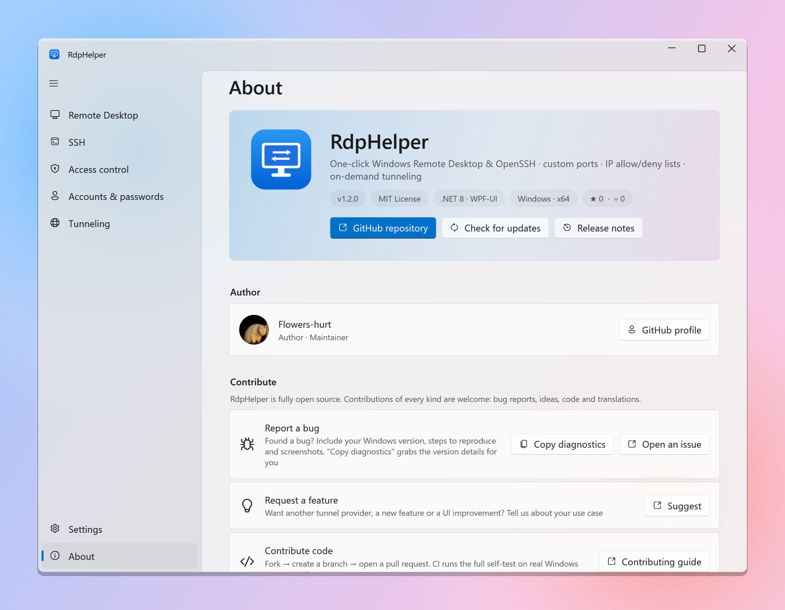

### ✨ Contributors

<a href="https://github.com/Flowers-hurt/RdpHelper/graphs/contributors">
  
</a>

### ⭐ Star history

<a href="https://star-history.com/#Flowers-hurt/RdpHelper&Date">
  <picture>
    <source media="(prefers-color-scheme: dark)" srcset="https://api.star-history.com/svg?repos=Flowers-hurt/RdpHelper&type=Date&theme=dark" />
    
  </picture>
</a>

## ⚠️ Disclaimer

This tool changes remote-access settings and may expose services to the internet. Use it only on machines you are authorized to manage. Tunnels are provided by third parties under their own terms.

## 📄 License

[MIT](LICENSE)

Thanks to [WPF-UI](https://github.com/lepoco/wpfui) · [cloudflared](https://github.com/cloudflare/cloudflared) · [ngrok](https://ngrok.com) · [bore](https://github.com/ekzhang/bore) · [Win32-OpenSSH](https://github.com/PowerShell/Win32-OpenSSH)
